# fluent2-egui

Fluent 2 themes, controls and Office-style application chrome for [egui](https://github.com/emilk/egui).

- **Themes** generated from the Fluent 2 design tokens: light, dark and high contrast, any
  brand colour from a single seed, and compact, medium and touch density.
- **Controls**: buttons, toggle, split and menu buttons, inputs, checkbox, radio, switch,
  slider, spin button, dropdown, combobox, tabs, pager, sparklines, badges and progress.
- **Surfaces**: dialog, drawer, bottom sheet, menus, tooltips, popovers, message bar, toasts,
  command palette, document tab strip and docking.
- **Data views**: virtualised data grid, list and tree view, terminal, diff, code and
  Markdown views.
- **Office chrome**: title bar, quick access toolbar, ribbon with keytips, backstage, command
  bar and status bar.

It runs natively on Windows and Linux, and on the web through wasm. Every control has
keyboard support and an AccessKit node.

**Live gallery:** https://thedancingdeveloper.github.io/fluent2-egui/

## Gallery

Rendered headlessly from the gallery app by
[`crates/gallery/tests/gallery_snapshots.rs`](crates/gallery/tests/gallery_snapshots.rs).
CI fails when an image is stale. Click a thumbnail for the full-size image.

<table>
<tr><td align="center" valign="top"><a href="docs/images/gallery/controls-light.png">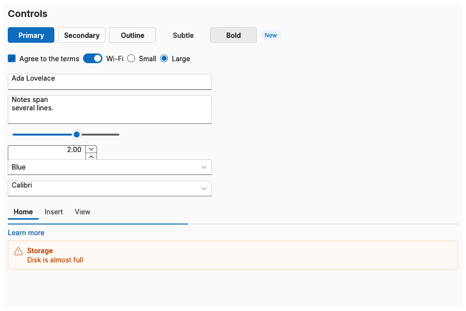</a><br><b>Controls</b><br><a href="docs/images/gallery/controls-dark.png">dark</a> · <a href="docs/images/gallery/controls-hc.png">high contrast</a> · <a href="crates/gallery/tests/gallery_snapshots.rs">source</a></td><td align="center" valign="top"><a href="docs/images/gallery/editor-light.png">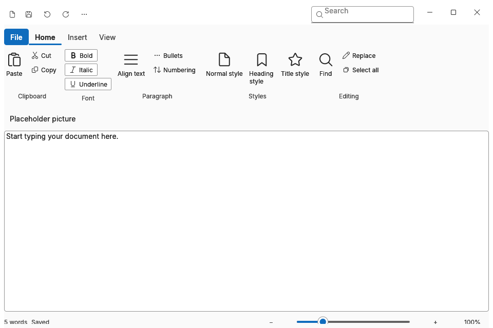</a><br><b>Office chrome (editor sample)</b><br><a href="docs/images/gallery/editor-dark.png">dark</a> · <a href="docs/images/gallery/editor-hc.png">high contrast</a> · <a href="crates/gallery/examples/editor.rs">source</a></td><td align="center" valign="top"><a href="docs/images/gallery/tokens-light.png">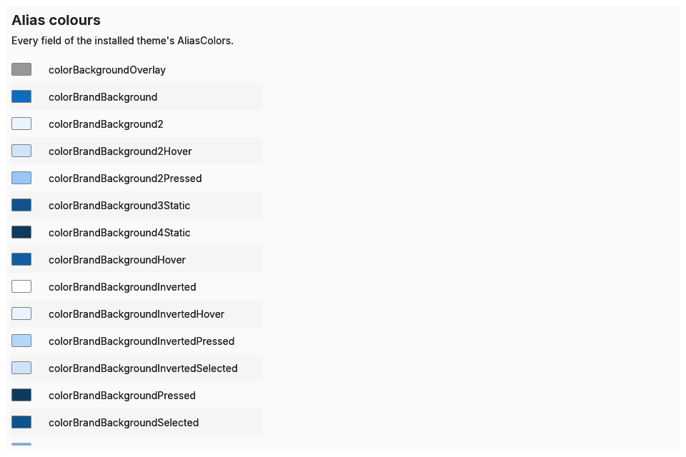</a><br><b>Tokens</b><br><a href="docs/images/gallery/tokens-dark.png">dark</a> · <a href="crates/gallery/src/pages/tokens.rs">source</a></td></tr>
<tr><td align="center" valign="top"><a href="docs/images/gallery/typography-light.png">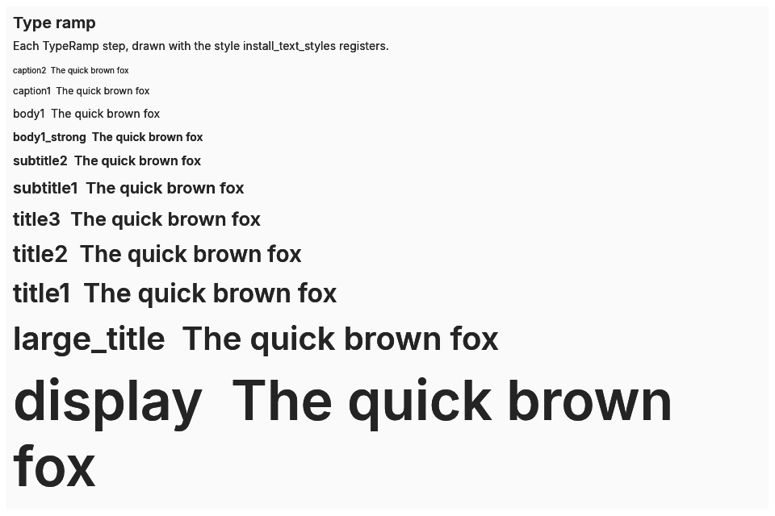</a><br><b>Typography</b><br><a href="docs/images/gallery/typography-dark.png">dark</a> · <a href="crates/gallery/src/pages/typography.rs">source</a></td><td align="center" valign="top"><a href="docs/images/gallery/icons-light.png">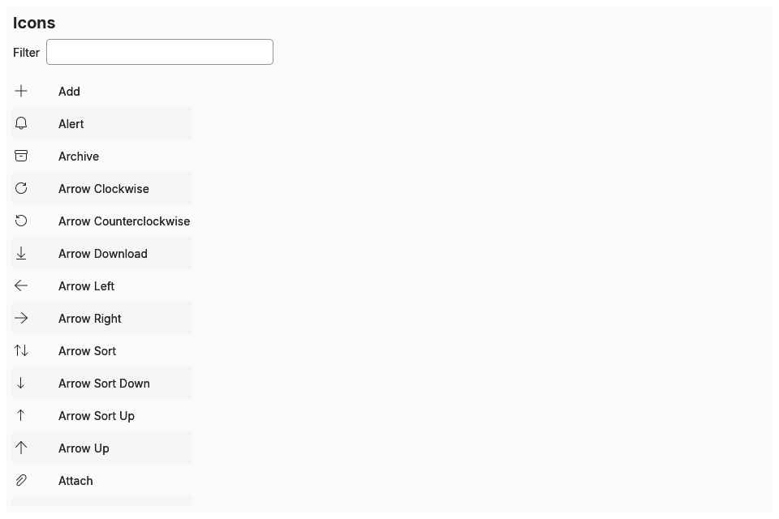</a><br><b>Icons</b><br><a href="docs/images/gallery/icons-dark.png">dark</a> · <a href="crates/gallery/src/pages/icons.rs">source</a></td><td align="center" valign="top"><a href="docs/images/gallery/datagrid-light.png">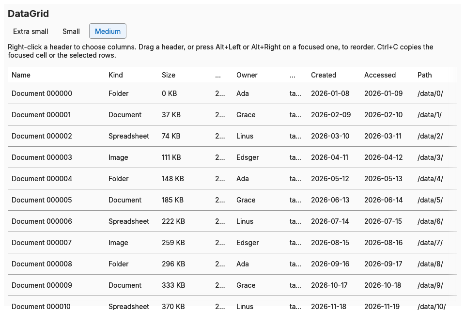</a><br><b>DataGrid</b><br><a href="docs/images/gallery/datagrid-dark.png">dark</a> · <a href="crates/gallery/src/pages/data_grid.rs">source</a></td></tr>
<tr><td align="center" valign="top"><a href="docs/images/gallery/list-rows-light.png">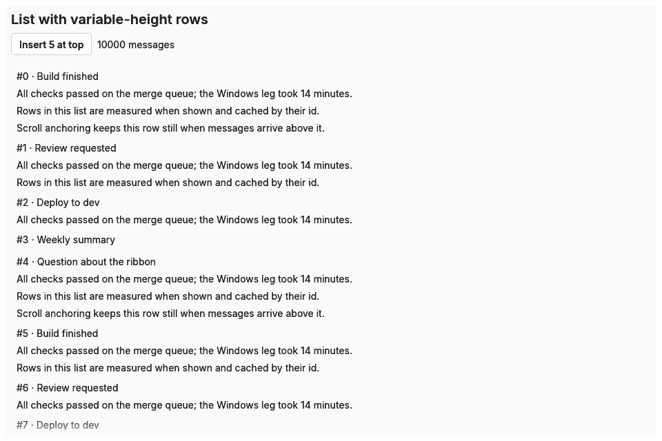</a><br><b>List rows</b><br><a href="docs/images/gallery/list-rows-dark.png">dark</a> · <a href="crates/gallery/src/pages/variable_list.rs">source</a></td><td align="center" valign="top"><a href="docs/images/gallery/pager-light.png">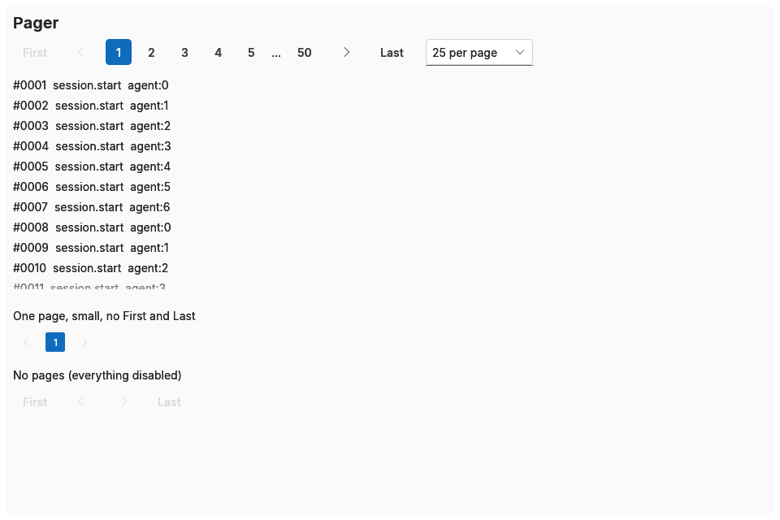</a><br><b>Pager</b><br><a href="docs/images/gallery/pager-dark.png">dark</a> · <a href="crates/gallery/src/pages/pager.rs">source</a></td><td align="center" valign="top"><a href="docs/images/gallery/backstage-light.png">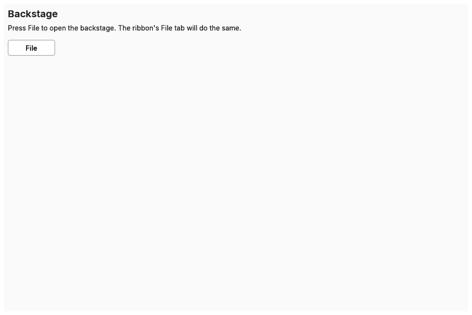</a><br><b>Backstage</b><br><a href="docs/images/gallery/backstage-dark.png">dark</a> · <a href="crates/gallery/src/pages/backstage.rs">source</a></td></tr>
<tr><td align="center" valign="top"><a href="docs/images/gallery/ribbon-light.png">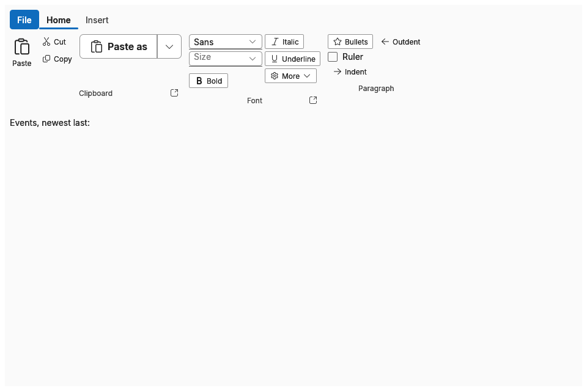</a><br><b>Ribbon</b><br><a href="docs/images/gallery/ribbon-dark.png">dark</a> · <a href="crates/gallery/src/pages/ribbon.rs">source</a></td><td align="center" valign="top"><a href="docs/images/gallery/terminal-light.png">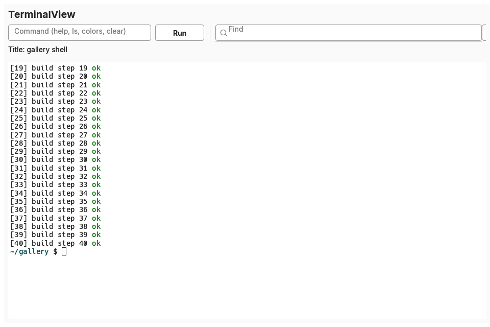</a><br><b>Terminal</b><br><a href="docs/images/gallery/terminal-dark.png">dark</a> · <a href="crates/gallery/src/pages/terminal.rs">source</a></td><td align="center" valign="top"><a href="docs/images/gallery/diff-light.png">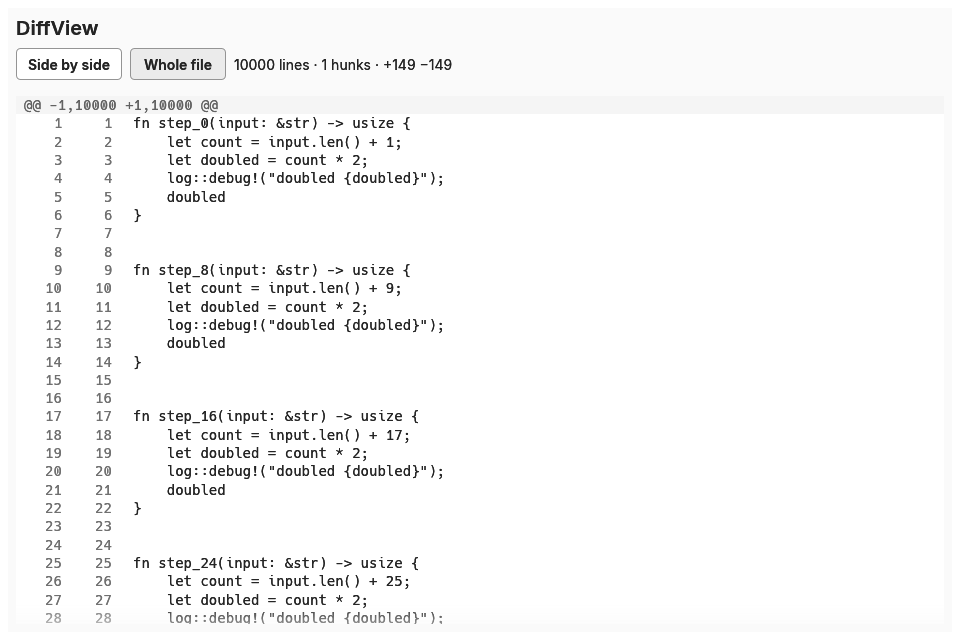</a><br><b>Diff</b><br><a href="docs/images/gallery/diff-dark.png">dark</a> · <a href="crates/gallery/src/pages/diff.rs">source</a></td></tr>
<tr><td align="center" valign="top"><a href="docs/images/gallery/code-view-light.png">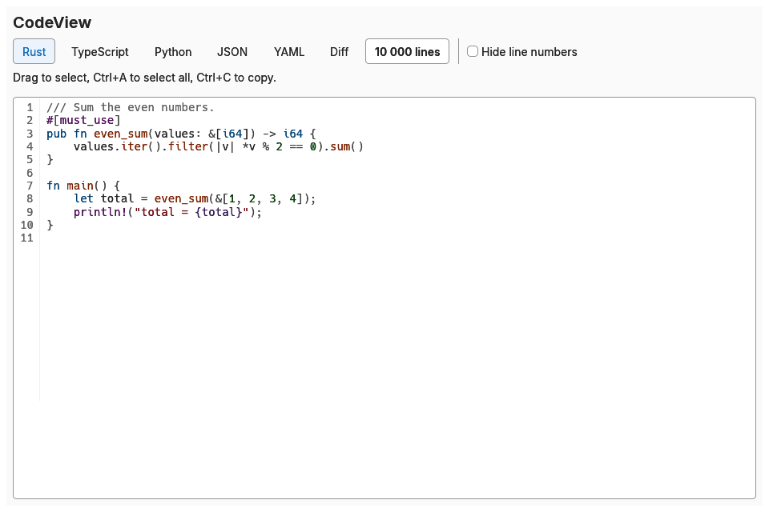</a><br><b>Code view</b><br><a href="docs/images/gallery/code-view-dark.png">dark</a> · <a href="crates/gallery/src/pages/code_view.rs">source</a></td><td align="center" valign="top"><a href="docs/images/gallery/command-palette-light.png">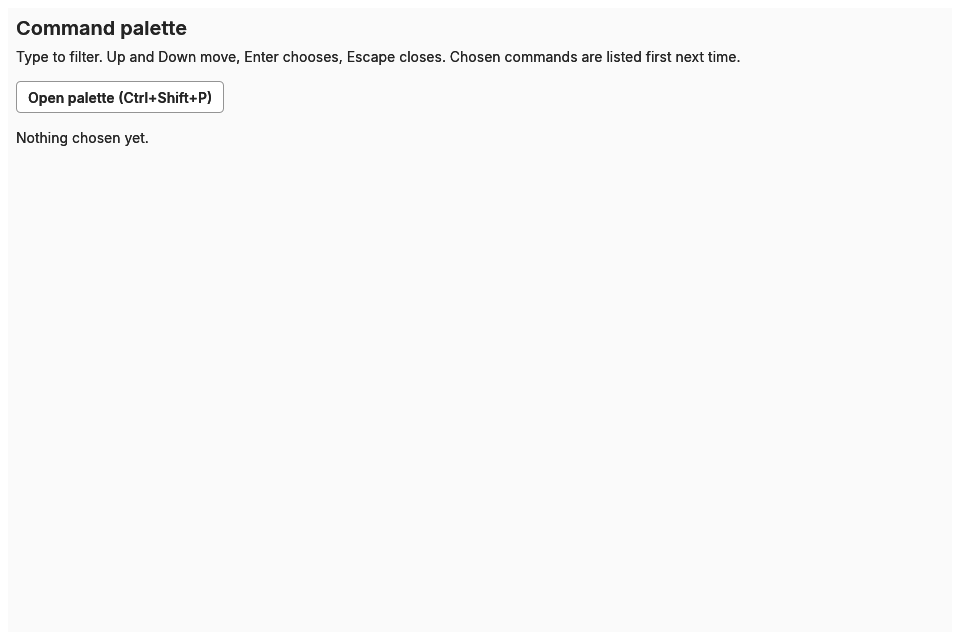</a><br><b>Command palette</b><br><a href="docs/images/gallery/command-palette-dark.png">dark</a> · <a href="crates/gallery/src/pages/command_palette.rs">source</a></td><td align="center" valign="top"><a href="docs/images/gallery/tab-strip-light.png">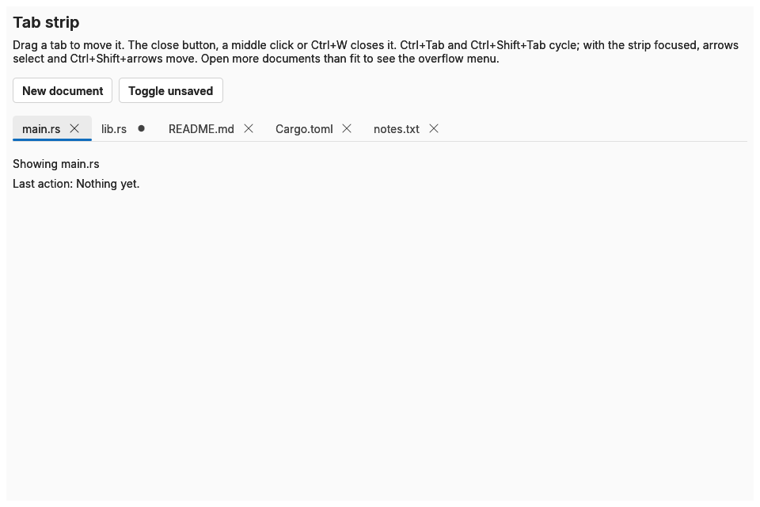</a><br><b>Tab strip</b><br><a href="docs/images/gallery/tab-strip-dark.png">dark</a> · <a href="crates/gallery/src/pages/tab_strip.rs">source</a></td></tr>
<tr><td align="center" valign="top"><a href="docs/images/gallery/file-dialog-light.png">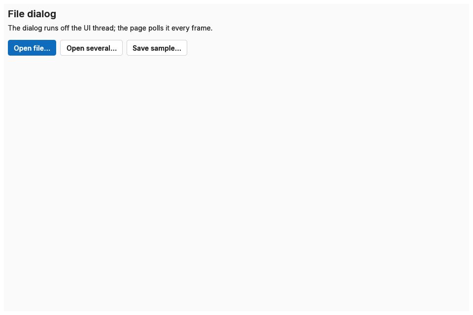</a><br><b>File dialog</b><br><a href="docs/images/gallery/file-dialog-dark.png">dark</a> · <a href="crates/gallery/src/pages/file_dialog.rs">source</a></td><td align="center" valign="top"><a href="docs/images/gallery/drawer-light.png">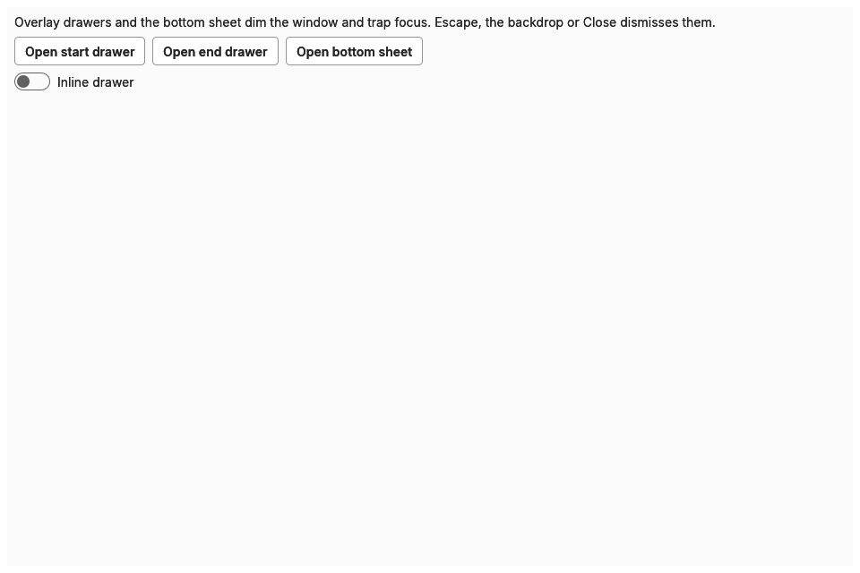</a><br><b>Drawer</b><br><a href="docs/images/gallery/drawer-dark.png">dark</a> · <a href="crates/gallery/src/pages/drawer.rs">source</a></td><td align="center" valign="top"><a href="docs/images/gallery/charts-light.png">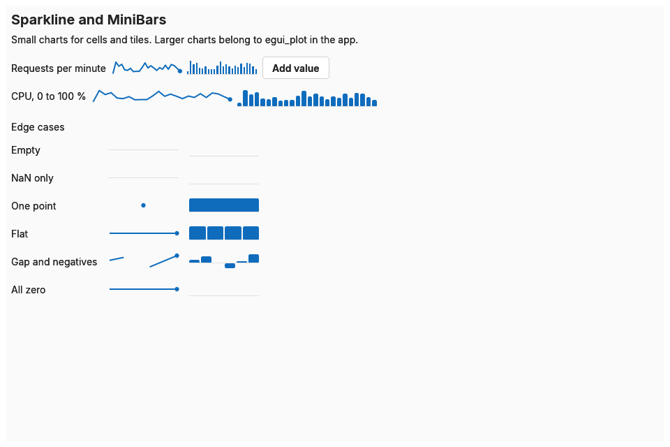</a><br><b>Charts</b><br><a href="docs/images/gallery/charts-dark.png">dark</a> · <a href="crates/gallery/src/pages/charts.rs">source</a></td></tr>
<tr><td align="center" valign="top"><a href="docs/images/gallery/docking-light.png">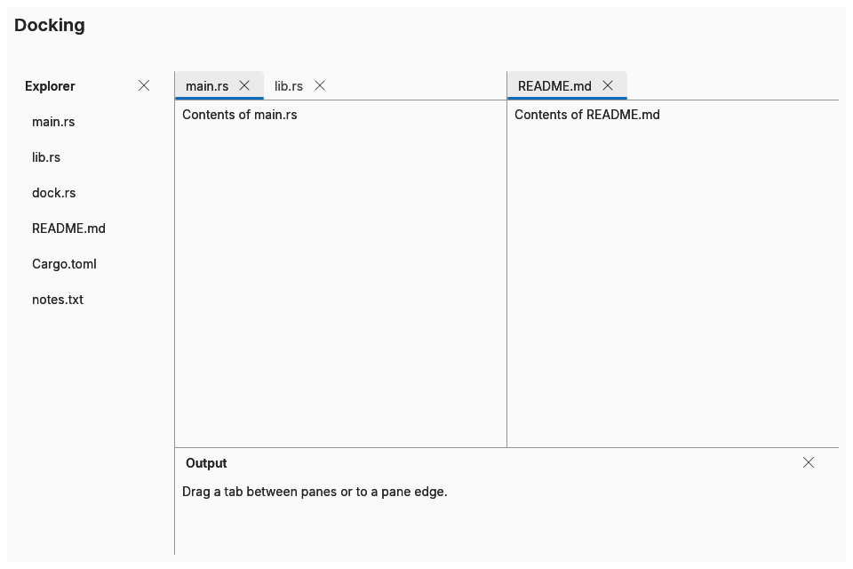</a><br><b>Docking</b><br><a href="docs/images/gallery/docking-dark.png">dark</a> · <a href="crates/gallery/src/pages/docking.rs">source</a></td><td align="center" valign="top"><a href="docs/images/gallery/reorder-light.png">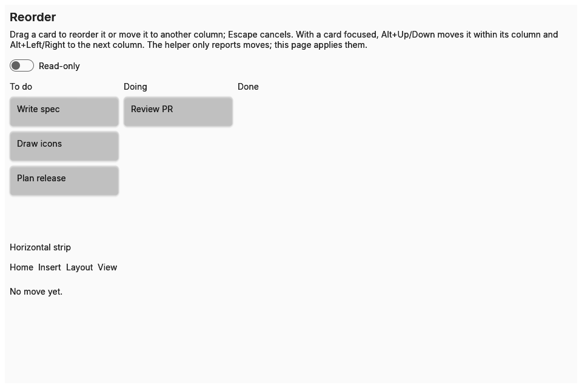</a><br><b>Reorder</b><br><a href="docs/images/gallery/reorder-dark.png">dark</a> · <a href="crates/gallery/src/pages/reorder.rs">source</a></td><td align="center" valign="top"><a href="docs/images/gallery/markdown-light.png">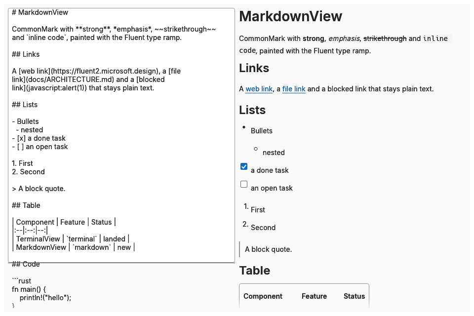</a><br><b>Markdown</b><br><a href="docs/images/gallery/markdown-dark.png">dark</a> · <a href="crates/gallery/src/pages/markdown.rs">source</a></td></tr>
</table>

To refresh the images, run `scripts/gallery-screenshots.sh --update` (needs Docker). See
[`docs/ci.md`](docs/ci.md#gallery-screenshots).

## Install

```toml
[dependencies]
egui = "0.36"
fluent2-egui = "0.1"
```

## Quick start

Install the theme once (it is safe to call again, for example when the user switches theme),
then use the controls like any egui widget:

```rust
use fluent2_egui::controls::{Appearance, Button};
use fluent2_egui::Theme;

fn ui(ctx: &egui::Context, ui: &mut egui::Ui) {
    fluent2_egui::install(ctx, &Theme::default());

    if ui.add(Button::new("Save").appearance(Appearance::Primary)).clicked() {
        // save
    }
}
```

A ribbon is built each frame from tabs, groups and controls, and reports clicks by key:

```rust
use fluent2_egui::office::ribbon::{FileTab, Ribbon, RibbonLarge, RibbonState, RibbonTab};
use fluent2_egui::IconName;

fn ribbon(ui: &mut egui::Ui, state: &mut RibbonState) {
    let response = Ribbon::new("main")
        .file_tab(FileTab::new("file", "File"))
        .tab(RibbonTab::new("home", "Home", |tab| {
            tab.group("clipboard", "Clipboard", |group| {
                group.add(RibbonLarge::new("paste", IconName::ClipboardPaste, "Paste"));
            });
        }))
        .show(ui, state);
    for event in response.events {
        println!("{} {:?}", event.key, event.kind);
    }
}
```

`cargo run -p gallery` opens the gallery, and `cargo run -p gallery --example editor`
runs a sample editor with the full Office chrome.

## Feature flags

| feature | default | adds |
|---|---|---|
| `bundled-font` | yes | Inter as the UI font off Windows (Windows uses the system Segoe UI) |
| `serde` | no | `Serialize`/`Deserialize` for view state: data grid, list, tree, split and nav views, dock layout, density |
| `system-preferences` | no | OS accent, high contrast, reduced motion and colour scheme (`theme_from_system`) |
| `terminal` | no | `data::terminal`: a VT grid and `TerminalView` |
| `diff` | no | `data::diff`: `DiffModel` and `DiffView` on imara-diff |
| `highlight` | no | `data::code`: syntax highlighting and `CodeView` on syntect |
| `markdown` | no | `data::markdown`: `MarkdownView` on pulldown-cmark |
| `docking` | no | `surfaces::{DockTree, DockArea, SideDock}` |
| `file-dialog` | no | `platform::file_dialog`: async native and web file dialogs on rfd |
| `snapshots` | no | test only: wgpu pixel snapshots |

## Crates

| crate | purpose |
|---|---|
| `fluent2-tokens` | Fluent 2 design tokens as plain Rust data (no UI dependency) |
| `fluent2-icons` | Fluent System Icons subset (MIT) |
| `fluent2-egui` | the egui library |
| `gallery` | the component gallery (native and wasm); not published |

## Compatibility

| fluent2-egui | egui | MSRV |
|---|---|---|
| 0.1.x | 0.36 | Rust 1.95 |

## Status

0.1.0, under active development. The M0–M4 milestones (foundations, Office chrome, core
controls, data and layout, the 0.1 release) are done. The later wave added density, the
terminal, diff, code and Markdown views, docking, the command palette and more. See
[`CHANGELOG.md`](CHANGELOG.md) and [`docs/BACKLOG.md`](docs/BACKLOG.md). The design rules are in
[`docs/ARCHITECTURE.md`](docs/ARCHITECTURE.md), and the component specs are in [`docs/specs/`](docs/specs/).

## CI

Pull requests run only the checks their diff touches. `main`, and the merge queue once it is
enabled, run the full suite on Linux and Windows. The single required check is `ci`. See
[`docs/ci.md`](docs/ci.md).

## Upstream sources

This project generates from, adapts and follows several fast-moving upstreams (egui, Fluent UI
tokens, Fluent System Icons, the storytold Craft apps). They are pinned and tracked in
[`upstream.toml`](upstream.toml); see [`UPSTREAM.md`](UPSTREAM.md).

## Licence

Dual-licensed under [MIT](LICENSE-MIT) or [Apache-2.0](LICENSE-APACHE), at your option, except
`fluent2-icons`, which is MIT only. Notices are in [NOTICE](NOTICE) and per-asset attribution is
in [ATTRIBUTION.md](ATTRIBUTION.md).

Not affiliated with or endorsed by Microsoft. "Fluent" refers to Microsoft's public Fluent 2
design system, whose open-source tokens and icons this project uses under their MIT licences.
Microsoft fonts are never bundled. On Windows the system's Segoe UI is used at runtime.
